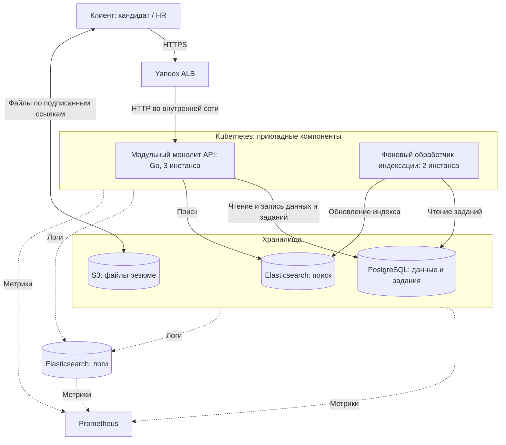

# Архитектура платформа поиска работы

Платформа помогает кандидатам искать работу, а работодателям подбирать сотрудников. Кандидаты размещают резюме и откликаются на вакансии. Работодатели публикуют вакансии, ищут кандидатов и обрабатывают отклики. Будем считать, что почти все пользователи находятся в России, и их распределение по регионам примерно совпадает с населением (т.е. большинство живут в западной части).

## 1. Задача и границы

### Актуальность и аналог

В январе 2026 года в России было 1,7 млн безработных, или 2,2% рабочей силы в возрасте от 15 лет, без сезонной корректировки. Потенциальная аудитория включает и тех, кто ищет новое место, продолжая работать. [Росстат, стр. 177](https://rosstat.gov.ru/storage/mediabank/osn-01-2026.pdf)

На сайте инвесторов hh.ru, аналога платформы, указаны более 33 млн активных пользователей в месяц (MAU) и 60 млн зарегистрированных пользователей. В этих данных нет периода измерения, географии и разбивки по ролям. Для расчёта нагрузки платформы принимаем **2 млн MAU кандидатов**. В предположении, что аудитория у нас Российская и будем конкуретнами hh.ru, и поначалу будем явно менее популярны. [Сайт инвесторов hh, данные страницы на 30.10.2026](https://investor.hh.ru/ru)

### Функции, входящие в проектирование

1. Кандидат заполняет структурированную анкету и загружает файл резюме. По полям анкеты HR может фильтровать кандидатов.
2. Кандидат ищет и просматривает вакансии.
3. Работодатель публикует, редактирует и закрывает вакансии.
4. HR ищет кандидатов и применяет фильтры по всей базе резюме.
5. Кандидат отправляет отклик, HR просматривает его и приглашает кандидата на собеседование или отказывает.

За пределами проектирование остаются платежи, платное продвижение, встроенный чат, видеособеседования, персональные рекомендации и функции на базе ML.

### Нефункциональные требования

| Требование | Цель |
|---|---|
| Доступность основных функций | 99,9% времени в месяц |
| Поиск вакансий и кандидатов | p95 до 500 мс включительно |
| Просмотр вакансии или анкеты | p95 до 300 мс включительно |
| Сохранение анкеты или вакансии, отправка отклика, приглашение или отказ | p95 до 500 мс включительно |
| Видимость собственных изменений | Сразу после подтверждения сохранения, включая повторное открытие |
| Обновление поискового индекса | Не позднее 30 секунд после сохранения в штатном режиме |
| Сохранность данных при отказе одного сервера | Без потери подтверждённых изменений |

Файлы передаются напрямую через S3, поэтому их трафик рассчитан отдельно. [Сетевой трафик](#сетевой-трафик)

Целевая доступность (SLO) 99,9% оставляет около 43,2 минуты недоступности за 30 дней. Поиск работы допускает короткие перерывы и не требует ответа в реальном времени.

### География аудитории

Распределяем MAU кандидатов по России пропорционально численности рабочей силы в каждом федеральном округе. Для такой оценки берём средние значения за период с ноября 2025 года по январь 2026 года. [Росстат, стр. 270-271](https://rosstat.gov.ru/storage/mediabank/osn-01-2026.pdf)

| Федеральный округ | Доля кандидатов | MAU кандидатов |
|---|---:|---:|
| Центральный | 28,5% | 570 000 |
| Северо-Западный | 9,9% | 198 000 |
| Южный | 11,3% | 226 000 |
| Северо-Кавказский | 6,5% | 130 000 |
| Приволжский | 19,1% | 382 000 |
| Уральский | 8,4% | 168 000 |
| Сибирский | 10,8% | 216 000 |
| Дальневосточный | 5,5% | 110 000 |
| Итого | 100% | 2 000 000 |

## 2. Аудитория и нагрузка

### Продуктовые метрики

| Параметр | Кандидаты | Представители работодателей |
|---|---:|---:|
| MAU | 2 000 000 | 80 000 |
| Активных дней за 30-дневный месяц | 10 | 20 |
| Средний DAU по календарным дням | Около 666 667 | Около 53 333 |
| Поисков за активный день | 5 | 5 |
| Карточек из поиска за активный день | 20 вакансий | 20 анкет |
| Откликов за активный день | 0,6 отправленного | 10 просмотренных |

Средний DAU считаем как `MAU × активные дни / 30`. HR работают в основном по будням. В активный день они открывают 20 анкет из поиска и отдельно просматривают 10 входящих откликов.

При 2 млн кандидатов, 10 активных днях и 0,6 отклика за день получаем **12 млн откликов в месяц**. Из расчёта 300 входящих откликов в месяц на компанию это даёт 40 тыс. активных компаний. Если в каждой компании по два активных представителя, аудитория со стороны работодателей составит 80 тыс. MAU. Считаем, что каждый представитель относится к одной компании.

Из 20 просмотров при конверсии 3% получаем 0,6 отклика за день. В трёх примерах hh.ru из ретейла до рекламы было 330 просмотров и 10 откликов в сумме. [Примеры hh.ru от 22.11.2021](https://hh.ru/article/29569)

### Допущения для технических расчётов

| Параметр | Расчётное допущение и основание |
|---|---|
| Накопленная база | 5 млн кандидатов, 200 тыс. HR и 100 тыс. компаний. По этой базе считаем объём хранения. |
| Резюме кандидата | Для подсчёта объектов берём одну текущую анкету и один текущий файл |
| Сохранение анкеты | 0,1 за активный день кандидата даёт 2 млн сохранений в месяц для оценки нагрузки записи |
| Изменение статуса отклика | 5 за активный день HR дают 8 млн изменений в месяц для оценки нагрузки записи |
| Публикация вакансий | По 3 на активную компанию в месяц, всего 120 тыс. публикаций |
| Редактирование вакансии | По 2 на публикацию, всего 240 тыс. изменений в месяц |
| Средний срок открытой вакансии | При сроке 30 дней и установившемся потоке одновременно открыты 120 тыс. вакансий |
| Закрытие вакансии | При установившемся потоке на каждую публикацию приходится одно закрытие. Всего 120 тыс. закрытий в месяц |
| Хранение закрытых вакансий и откликов | 12 месяцев для оценки накопленного объёма |
| Средний файл резюме | 1 MB для оценки хранения и трафика |
| Загрузка файла | При 25% сохранений анкеты получаем 500 тыс. загрузок в месяц |
| Скачивание файла | Считаем, что 25% просмотров заканчиваются скачиванием. При 32 млн просмотров анкет из поиска и 16 млн просмотров откликов получаем 12 млн скачиваний в месяц |
| Пиковые коэффициенты | ×5 для кандидатов, ×7 для HR; больший коэффициент HR учитывает концентрацию в будни и рабочие часы |


### RPS по основным операциям

```text
Запросов в месяц = MAU × активные дни × действия за активный день.
Средний RPS = запросы в месяц / 2 592 000.
Пиковый RPS = средний RPS × коэффициент группы.
```

| Операция | Запросов за месяц | Средний RPS | Пиковый RPS |
|---|---:|---:|---:|
| Поиск вакансий | 100 000 000 | 38,58 | 192,90 |
| Просмотр вакансии | 400 000 000 | 154,32 | 771,60 |
| Сохранение анкеты | 2 000 000 | 0,77 | 3,86 |
| Отправка отклика | 12 000 000 | 4,63 | 23,15 |
| Поиск кандидатов | 8 000 000 | 3,09 | 21,60 |
| Анкета из поиска | 32 000 000 | 12,35 | 86,42 |
| Просмотр входящего отклика | 16 000 000 | 6,17 | 43,21 |
| Изменение статуса отклика | 8 000 000 | 3,09 | 21,60 |
| Публикация и редактирование вакансий | 360 000 | 0,14 | 0,97 |
| Закрытие вакансии | 120 000 | 0,05 | 0,32 |
| Выдача ссылки для загрузки резюме | 500 000 | 0,19 | 0,96 |
| Выдача ссылки для скачивания резюме | 12 000 000 | 4,63 | 32,41 |
| API, всего | 590 980 000 | 228,00 | 1 199,02 |

Общий пик считаем как сумму пиков обеих групп. Загрузки дают 0,19 запроса/с в среднем и 0,96 на пике, скачивания соответственно 4,63 и 32,41 запроса/с.

### Сетевой трафик

Для расчёта трафика примем такие размеры запросов и ответов.

| Операции | Запрос, kB | Ответ, kB |
|---|---:|---:|
| Поиск вакансий или кандидатов | 1 | 20 |
| Карточка вакансии или анкета | 1 | 10 |
| Входящий отклик с анкетой | 1 | 11 |
| Сохранение анкеты, публикация или редактирование вакансии | 10 | 1 |
| Отправка отклика, изменение его статуса или закрытие вакансии | 1 | 1 |
| Выдача подписанной ссылки | 1 | 1 |

В поисковой выдаче 20 кратких карточек по 1 kB. Файл резюме занимает 1 MB, запрос скачивания и подтверждение загрузки весят по 1 kB. Направления трафика указаны относительно системы.

```text
Трафик за месяц = запросы за месяц × размер сообщения.
Средняя скорость в bit/s = байтов за месяц × 8 / 2 592 000.
Пиковая скорость = сумма (пиковый RPS операции × байтов × 8).
```

| Поток | Входящий, TB/мес. | Исходящий, TB/мес. | Входящий пик, Mbit/s | Исходящий пик, Mbit/s |
|---|---:|---:|---:|---:|
| API, включая выдачу ссылок | 0,6122 | 6,6910 | 9,94 | 107,43 |
| Загрузка файлов резюме | 0,5000 | 0,0005 | 7,72 | 0,01 |
| Скачивание файлов резюме | 0,0120 | 12,0000 | 0,26 | 259,26 |
| Всего | 1,1242 | 18,6915 | 17,92 | 366,70 |

Средняя скорость входящего трафика 3,47 Mbit/s, исходящего 57,69 Mbit/s.

### Объекты и объём хранения
Пока посчитаем полезный объем. В отклике храним текущий статус и ссылки на основные сущности. Анкету и файл учитываем отдельно.

```text
Открытые вакансии = 120 тыс. публикаций/мес. × 1 месяц = 120 тыс.
Закрытые вакансии = 120 тыс./мес. × 12 месяцев = 1,44 млн.
Отклики = 12 млн/мес. × 12 месяцев = 144 млн.
Объём категории = число объектов × средний размер объекта.
```

| Категория | Количество объектов | Средний размер, kB | Полезный объём, TB |
|---|---:|---:|---:|
| Профили кандидатов и HR | 5 200 000 | 2 | 0,0104 |
| Профили компаний | 100 000 | 5 | 0,0005 |
| Структурированные анкеты | 5 000 000 | 10 | 0,0500 |
| Файлы резюме | 5 000 000 | 1 000 | 5,0000 |
| Вакансии, включая закрытые | 1 560 000 | 10 | 0,0156 |
| Отклики с текущим статусом | 144 000 000 | 1 | 0,1440 |
| Итого | | | 5,2205 |

Для расчёта на пользователя берём всю накопленную базу зарегистрированных пользователей. Общий объём данных о компаниях и их вакансиях делим между HR.

| Роль | Данные | Среднее число объектов | Объём на пользователя, GB |
|---|---|---:|---:|
| Кандидат | Профиль | 1 | 0,000002 |
| Кандидат | Структурированная анкета | 1 | 0,000010 |
| Кандидат | Файл резюме | 1 | 0,001000 |
| Кандидат | Отклики | `144 млн / 5 млн = 28,8` | 0,0000288 |
| Кандидат | Всего | | 0,0010408 |
| HR | Профиль | 1 | 0,000002 |
| HR | Доля профиля компании | `100 тыс. / 200 тыс. = 0,5` | 0,0000025 |
| HR | Доля вакансий | `1,56 млн / 200 тыс. = 7,8` | 0,000078 |
| HR | Всего | | 0,0000825 |

Оценка в 5,2205 TB уже включает все данные, которые здесь распределены по пользователям. Рост и репликацию считаем ниже в разделе «Системы хранения данных».

## 3. Архитектура и балансировка нагрузки

### Логические компоненты

API обращается к поисковому индексу за выдачей вакансий и кандидатов. Карточки он читает из основной БД и туда же записывает изменения. Фоновый обработчик обновляет индекс после записи в БД. [Состав компонентов](#состав-компонентов), [Схема](#схема)

Чтобы загрузить или скачать резюме, клинет запрашивает у API подписанную ссылку. API проверяет права и выдаёт временную ссылку для загрузки или скачивания конкретного файла. Дальше клиент передаёт файл напрямую в S3 или скачивает его оттуда. После успешной загрузки клиент отправляет ключ файла при сохранении анкеты, а API привязывает файл к анкете и записывает ключ в PostgreSQL.

### Размещение и маршрутизация

Система размещается в одном регионе в России. Экземпляры API и узлы балансировщика распределяем по трём зонам доступности. При пике около 1 199 API RPS и заданной доступности глобальная балансировка не нужна.

Наши цели по таймингам p95 относятся именно к таймингам на стороне API, и запросы из дальних восточных регионов по факту могут занимать больше времени.

### Инструмент и алгоритм

В российском регионе Yandex Cloud используем управляемый сервис Yandex Application Load Balancer. Он работает в нескольких зонах. Инфраструктуру балансировщика обслуживает провайдер. Использование Envoy тут выглядит нецелесообразно: Yandex уже предоставляет все необходимое, какая-то особая гибкость в балансировке не требуется.

Поиск, чтение и запись могут занимать разное время, поэтому выбираем `LEAST_REQUEST` (все эти операции у нас будут жить в одном микросервисе).

### Проверки готовности и транспорт

- Следующий запрос пользователя может обработать любой готовый stateless экземпляр API.
- ALB исключает из балансировки экземпляры API, которые перестали проходить HTTP health checks, и возвращает их после восстановления. Panic mode отключаем, чтобы это правило действовало и при массовом сбое.
- От клиента до ALB используем HTTPS. TLS завершается на балансировщике, дальше запрос идёт по HTTP во внутренней сети.

## 4. Системы хранения данных

### Категории данных и выбор систем

| Категория | Хранилище | Основание выбора |
|---|---|---|
| Профили кандидатов, HR и компаний, анкеты, вакансии, отклики, идентификаторы файлов | PostgreSQL | Структурированные данные, ограничения целостности и транзакции |
| Индексы вакансий и анкет | Elasticsearch, отдельный поисковый кластер | Полнотекстовый поиск и фильтры; независимое масштабирование поиска |
| Файлы резюме | S3-совместимое объектное хранилище | Доступ к файлам по ключу, прямая загрузка и скачивание по подписанным ссылкам |
| Служебные логи | Elasticsearch, отдельный кластер логов | Поиск и фильтрация событий по времени, ошибкам и компоненту |
| Метрики наблюдаемости | Prometheus | Сбор и хранение временных рядов, алерты |
| Задания обновления поискового индекса | PostgreSQL и фоновый обработчик | Задание и изменение данных сохраняются одной транзакцией |
| Резервные копии и предыдущие версии файлов | Копии в отдельном закрытом бакете S3. Предыдущие версии резюме в рабочем бакете | Восстановление после удаления или замены файла по ошибке |

На исходном пике ждём около 772 просмотров вакансий/с. Предполагаем, что чтения распределятся по разным карточкам примерно равномерно, поэтому читаем их напрямую из PostgreSQL без отдельного кэша. Было бы более целесообразно использовать Redis для сохранения карточек компаний, просмотр таких карточек за рамками проектирования.

### Обоснование и альтернативы

- **PostgreSQL для основных данных.** Нужна реляционность.
- **Elasticsearch для поиска.** Совмещает поиск по тексту с фильтрами. Поиск в PostgreSQL добавил бы нагрузку на базу, которая уже обслуживает чтение карточек и запись данных. Можно и OpenSearch.
- **S3 для файлов резюме.** Для медиа нужно какое-то объяетное хранилище.
- **Elasticsearch для логов.** Можно искать ошибки по времени и компоненту. При хранении логов в S3 для этого пришлось бы читать и разбирать файлы.
- **Prometheus для метрик.** Собирает метрики, хранит их 30 дней и определяет, когда сработает алерт. Удобно интегрировать с тем же самым AlertManager.
- **PostgreSQL для тасок индексации.** Тут нужна табличка, из которой фоновый обработчик обновления индекса будет вычитывать задания. Для этой задачи неплохо подошел бы брокер сообщений, но на индексацию у нас маленький RPS (8 в пике), и ради такого небольшого RPS не хотелось бы поднимать отдельный брокер сообщений. Поэтому можно будет просто переиспользовать тот кластер с Postgres, который у нас есть.

### Объёмы с ростом и репликацией

К концу года закладываем рост аудитории в 1,5 раза, до 3 млн MAU кандидатов и 120 тыс. MAU представителей работодателей. Накопленную базу увеличиваем в те же 1,5 раза. Число действий на пользователя и размеры основных объектов остаются прежними.

| Основные данные | Объектов на конец года | Полезный объём, TB |
|---|---:|---:|
| Профили кандидатов и HR | 7 800 000 | 0,0156 |
| Компании | 150 000 | 0,00075 |
| Структурированные анкеты | 7 500 000 | 0,075 |
| Вакансии с архивом | 2 340 000 | 0,0234 |
| Отклики с текущим статусом | 216 000 000 | 0,216 |
| Основные данные PostgreSQL | 233 790 000 | 0,33075 |
| Файлы резюме | 7 500 000 | 7,5 |

Каждое сохранение анкеты, публикация, редактирование или закрытие вакансии создаёт задание на 1 kB. После роста ждём 124 тыс. заданий в сутки. Место нужно под суточную очередь и примерно сутки истории выполненных заданий между штатными снимками. Поисковый документ занимает 10 kB, а для логов считаем одну запись размером 1 kB на запрос к API. Для метрик после роста берём 75 тыс. рядов с отсчётом каждые 15 секунд и ориентир 2 B на отсчёт.

Для учёта индексов и служебных данных берём ориентировочные коэффициенты. Для PostgreSQL это 1,5, для Elasticsearch 2, для Prometheus 1,5. Логи и метрики храним 30 дней.

| Хранилище | Данные и количество | Объём с индексами/служебными данными и копиями, TB |
|---|---|---:|
| PostgreSQL | Около 234 млн основных записей и около 248 тыс. записей в очереди и истории заданий | Около 1,49 |
| Elasticsearch: поиск | 7,68 млн документов анкет и открытых вакансий | Около 0,31 |
| Elasticsearch: логи | Около 886 млн записей за 30 дней | Около 3,55 |
| S3: файлы резюме | 7,5 млн текущих файлов, столько же резервных копий и до 750 тыс. предыдущих версий | До 15,75 (логический объём) |
| S3: полные копии PostgreSQL | 30 ежедневных копий базы | Около 15 (логический объём до сжатия) |
| Prometheus | 75 тыс. рядов и около 13 млрд отсчётов за 30 дней на экземпляр | Около 0,078 на два экземпляра |

Считаем три полные копии PostgreSQL, основную копию и одну реплику каждого шарда Elasticsearch, два независимых экземпляра Prometheus. В учебной модели три внутренние копии текущих файлов резюме занимают 22,5 TB. Схему хранения выбирает поставщик S3.

Под резюме в S3 закладываем 7,5 TB на текущие файлы, ещё 7,5 TB на резервный набор и до 0,75 TB на прежние версии за 30 дней. При росте в 1,5 раза число загрузок увеличится с 500 тыс. до 750 тыс. в месяц. Если каждая загрузка заменяет файл, накопится до 750 тыс. прежних версий по 1 MB.

Одна полная копия PostgreSQL с индексами занимает около 0,50 TB. Храним в S3 по копии за каждый из 30 дней, всего около 15 TB до сжатия. Вместе с резюме и условным запасом в 2 GB на служебные файлы (WAL и т.д.) выходит около 32 TB в S3.

### Аппаратные ресурсы

CPU, RAM, диски и сеть указаны на одну ноду.

| Система | Узлов | CPU | RAM | Диск на ноду | Сеть на ноду |
|---|---:|---:|---:|---|---|
| PostgreSQL | 3 | 8 vCPU | 32 GB | 1 TB NVMe | 1 Gbit/s |
| Elasticsearch: поиск | 3 | 8 vCPU | 32 GB | 300 GB NVMe | 1 Gbit/s |
| Elasticsearch: логи | 3 | 4 vCPU | 16 GB | 3 TB SSD | 1 Gbit/s |
| Prometheus | 2 | 2 vCPU | 8 GB | 100 GB SSD | 1 Gbit/s |
| S3-совместимое хранилище | Готовый сервис | Ресурсы провайдера | Ресурсы провайдера | Около 32 TB логически для резюме, полных копий PostgreSQL и служебные файлы | От 1 Gbit/s для сервиса |

- **PostgreSQL.** Данные с индексами займут около 0,50 TB на ноду. Остальное место на диске в 1 TB оставляем под WAL и обслуживание базы. NVMe выбрали для случайных чтений и записи WAL.
- **Elasticsearch.** При отказе одной ноды две оставшиеся должны вместить обе копии каждого шарда. Для этого нужно около 154 GB на ноду поиска и 1,77 TB на ноду логов.
- **Prometheus.** 30 дней метрик займут около 39 GB на экземпляр. Выделяем SSD на 100 GB.
- **S3.** После роста пиковый трафик скачивания резюме составит около 389 Mbit/s. Закладываем 1 Gbit/s сети.

### Наблюдаемость

Prometheus получает метрики от компонентов, экспортёров и API провайдера S3. Логи отправляем в отдельный кластер Elasticsearch. В Prometheus задаём правила оповещений.


| Система | Основные метрики |
|---|---|
| PostgreSQL | Задержки и ошибки запросов, подключения, блокировки, CPU/RAM, диск, отставание реплик, возраст заданий индексации, состояние бэкапов и архивации WAL |
| Elasticsearch: поиск | Задержки и ошибки поиска, отставание индекса от PostgreSQL, состояние кластера и шардов, JVM heap/GC, CPU и диск |
| Elasticsearch: логи | Скорость, ошибки и задержка индексации, состояние шардов, JVM heap/GC и диск |
| S3 | Задержки и ошибки GET/PUT, трафик, объём объектов и состояние резервного копирования (но тут уже не выбираем, дает провайдер) |
| Prometheus | Ошибки и длительность сбора, число рядов и скорость отсчётов, RAM, диск |

### Надёжность, настройки и масштабирование

| Система | Надёжность и бэкапы | Настройки и масштабирование |
|---|---|---|
| PostgreSQL | Primary и две реплики в трёх зонах. Подтверждаем запись после сохранения на primary и одной из реплик. В S3 отправляем ежедневные полные бэкапы и непрерывно архивируем WAL. | Используем пул подключений. Партицируем отклики по месяцам. При росте увеличиваем ресурсы primary и направляем часть чтений на реплики. |
| Elasticsearch (поиск и логи) | В каждом кластере три узла. Для выбора master нужны два из трёх. У каждого шарда две копии в разных зонах. Снимки храним в S3, для поиска делаем их ежедневно. | Индексы логов создаём по дням и удаляем через 30 дней. При росте добавляем узлы в нужный кластер и распределяем по ним шарды. |
| S3 | Требуем от провайдера хранить копии в разных зонах. Для резюме включаем версионирование и держим бэкап в отдельном бакете. | Старые версии храним 30 дней. При росте увеличиваем ёмкость и пропускную способность средствами провайдера. |
| Prometheus | Два экземпляра в разных зонах собирают одни и те же метрики. Снимки храним в S3. | Собираем метрики каждые 15 секунд, храним 30 дней. При росте увеличиваем ресурсы или делим источники метрик между парами экземпляров. |

API пишет в primary PostgreSQL и оттуда же читает свежие изменения пользователя. Запросы на чтение, для которых допустимо отставание, можно отправлять на реплики. Если нельзя гарантировать, что primary единственный и актуальный или что запись сохранится синхронно, временно останавливаем запись. При текущей нагрузке PostgreSQL работает без горизонтального шардирования.

При отказе узла используем реплику. После ошибочного изменения данных восстанавливаем их из бэкапа. Копии держим в отдельном закрытом S3-бакете. Для PostgreSQL и файлов резюме храним историю восстановления за 30 дней.

Кандидаты загружают файлы в рабочий бакет, откуда их скачивают рекрутеры. После замены файла его прежняя версия остаётся там на 30 дней. В резервном бакете держим одну копию каждого текущего файла и обновляем её ежедневно. Если сотрудник по ошибке удалит файл вместе с его версиями, копию можно вернуть в рабочий бакет.

#### Восстановление поиска из снимка

Elasticsearch копирует части индекса в разное время, поэтому задания обновления индекса, выполненные во время снимка, оставляем в PostgreSQL. Когда снимок готов, удаляем только выполненные задания, чьи изменения попали в индекс до начала снимка. Если снимок не получился, сохраняем всю историю до следующего успешного снимка.

Если потеряем рабочие копии индекса, сначала загрузим последний полный снимок из S3. Обработчик повторит сохранённые задания и применит изменения, накопившиеся в PostgreSQL за время восстановления. Поиск возвращаем в работу после обработки накопившихся изменений. Если снимок непригоден, индекс можно перестроить из PostgreSQL. На наших объемах, это будет не очень долго.

Тут очень тяжело оценить даунтайм, который будет, при потере индекса. Поиск - ключевая функциональность. Если не будем попадать в SLA, возможно, нужно рассмотреть вариант какого-то аварийного поиска (возможно, урезанного), прямо из PostgreSQL.

## 5. Программные инструменты и аппаратное обеспечение

### Язык, runtime и архитектура приложения

| Компонент | Язык и runtime | HTTP-стек |
|---|---|---|
| API, модульный монолит | Go, Go runtime | `net/http` и `chi` для маршрутов по модулям и middleware |
| Фоновый обработчик индексации | Go, Go runtime | Стандартный HTTP-клиент `net/http` |

Горутины очень хорошо подходят для таких задач, когда нет особой логический сложности (сложной обработки) на стороне самого сервиса, а сервис просто ходит в другие сервисы.

Модули API вызывают друг друга внутри одного процесса. Связанные изменения сохраняем одной транзакцией PostgreSQL. Фоновый обработчик обновляет поиск вне запроса пользователя.

### Состав компонентов

| Компонент | Роль |
|---|---|
| Клиент кандидата или HR | Обращения к API, прямая передача файлов в S3 |
| Yandex ALB | Завершение TLS и распределение запросов между экземплярами API |
| API на Go, модульный монолит | Профили и резюме, вакансии, отклики; права, валидация, транзакции и подписанные ссылки |
| Фоновый обработчик | Чтение заданий PostgreSQL и обновление поискового индекса |
| PostgreSQL | Основные данные и задания индексации |
| Elasticsearch: поиск | Поиск по вакансиям и анкетам |
| S3-совместимое хранилище | Файлы резюме и резервные копии |
| Elasticsearch: логи | Хранение и поиск служебных логов |
| Prometheus | Сбор и хранение метрик наблюдаемости |

### Схема




### Ресурсы API и обработчика

| Компонент | Копий | CPU на Pod | RAM на Pod | Диск | Сеть |
|---|---:|---:|---:|---|---|
| API, модульный монолит | 3, по зонам | 4 vCPU | 8 GB | 20 GB SSD на экземпляр | 1 Gbit/s |
| Обработчик индексации | 2, в разных зонах | 1 vCPU | 2 GB | 20 GB SSD на экземпляр | 1 Gbit/s |

После роста API получает около 1 799 запросов/с на пике. При равномерной балансировке три копии обслуживают примерно по 600 запросов/с. Если одна копия отказывает, нагрузка на каждую из оставшихся возрастает примерно до 899 запросов/с. Для API закладываем 4 vCPU и 8 GB на инстанс Для обработчика при пике около 7,73 задания/с закладываем 1 vCPU и 2 GB на копию.

На локальном диске лежат образы и временные служебные данные. 20 GB должно хватать. При исходящем пике API около 161 Mbit/s сеть заложим 1 Gbit/s для запаса. Для обращений внутри региона закладываем RTT порядка нескольких миллисекунд.

| Назначение | Тип диска | Ориентир IOPS | Ориентир throughput |
|---|---|---:|---:|
| PostgreSQL и поисковый Elasticsearch | NVMe | 10 000 | 500 MB/s |
| Elasticsearch для логов | SSD | 3 000 | 250 MB/s |
| API, обработчик и Prometheus | SSD | 1 000 | 50 MB/s |


### Инструменты тестирования

| Вид | Инструмент | Назначение и обоснование |
|---|---|---|
| Unit | Go `testing` | Валидация и правила обработки откликов; стандартный пакет выбранного языка |
| Интеграционное | Go `testing` и Testcontainers-Go | Изолированные PostgreSQL и Elasticsearch для сценариев сохранения анкеты вместе с заданием и обновления поиска |
| Нагрузочное | k6 | HTTP-сценарии поиска, просмотра карточек и откликов по рассчитанному профилю нагрузки |


### Виртуализация и контейнеризация

Собираем контейнерные образы API и обработчика с помощью Docker.

Будем использовать Kubernetes в качестве оркестратора. Он позволяет гибко и удобно задавать требуемые конфигурации (в том числе, требуемое разделение по зонам) и самостоятельно их поддерживать.

В текущей версии архитектуры Kubernetes является излишним. Но потенциально, когда в сервисе появятся новые сервисы (рекомендации, звонки, чаты и т.д.), расширение будет значительно проще.


## 6. Взаимодействие компонентов

### Схемы и протоколы

| Кто с кем взаимодействует | Тип и протокол | Назначение и обоснование |
|---|---|---|
| От клиента через Yandex ALB к API | Синхронно, REST с JSON. HTTPS до ALB, дальше HTTP | Карточки, поиск, сохранение, отклики и выдача подписанных ссылок. Клиент ждёт результата операции |
| От API к PostgreSQL | Синхронно, SQL | Основные данные и транзакции. API подтверждает сохранение после фиксации данных |
| От API к поисковому Elasticsearch | Синхронно, HTTP API с JSON | Поиск вакансий и кандидатов с фильтрами. Результат нужен для текущей выдачи |
| От обработчика к PostgreSQL и Elasticsearch | Асинхронно относительно сохранения. Чтение заданий через SQL, запись индекса через HTTP API | Обработчик обновляет индекс вне пользовательского запроса и может повторить задание при сбое |
| Между клиентом и S3 | Прямая передача по подписанным ссылкам через HTTPS и S3 API | Файлы идут отдельно от API-трафика. API проверяет права до выдачи ссылки |
| От компонентов к Elasticsearch для логов | Фоновая доставка служебных логов | По логам можно найти ошибки взаимодействия компонентов |
| Prometheus опрашивает компоненты и экспортёры | Периодический сбор метрик | Наблюдение за задержками, ошибками и отставанием обработки |
| От хранилищ к S3 | Фоновые резервные копии через S3 API | Восстановление по политике резервного копирования из раздела 4 |


### Поиск вакансий

Клиент отправляет запрос и фильтры в API через ALB. API обращается в Elasticsearch и возвращает страницу выдачи. Когда кандидат открывает вакансию, API читает карточку из PostgreSQL.

### Асинхронная обработка и альтернативы брокеров

Задания индексации храним в PostgreSQL, откуда их забирает фоновый обработчик. Данные и задание записываем одной транзакцией. Поток один, на пике около 7,73 задания/с, так что отдельный брокер здесь не нужен (обсуждалось выше).

### Закрытие вакансии и приём откликов

Когда работодатель закрывает вакансию, API одной транзакцией PostgreSQL сохраняет статус «закрыта» и создаёт задание (на удаление из индекса). Обработчик сверяет статус в PostgreSQL и удаляет вакансию из поискового индекса Elasticsearch.

Пока индекс не обновился, кандидат может увидеть закрытую вакансию в выдаче. При отклике API в одной транзакции проверяет статус в PostgreSQL, блокирует его изменение и создаёт отклик, если вакансия открыта. Иначе возвращает сообщение "Вакансия закрыта" (в нормальном состоянии такое возможно не позднее 30 секунд после закрытия вакансии).

### Гарантии, повторы и таймауты

| Аспект | Решение |
|---|---|
| Транзакционность | API сохраняет основные изменения и задание индексации одной транзакцией PostgreSQL. |
| Гарантии обработки | At-least-once. Обработчик может повторить неподтверждённое задание. Идемпотентность и контроль версии защищают индекс от дубликатов и перезаписи новых данных старыми |
| Retry | При временных ошибках применяем exponential retry. |
| DLQ | Если повторы не помогли, оставляем задание в PostgreSQL для разбора. После исправления причины задание можно запустить заново |
| Таймауты и дедлайны | API ждёт ответа от PostgreSQL, Elasticsearch и других зависимостей ограниченное время. Безопасные операции повторяем в пределах общего времени обработки запроса |

При at-most-once обновление индекса могло бы потеряться. PostgreSQL и Elasticsearch подтверждают записи отдельно, поэтому для индексации выбираем at-least-once с ретраями.

При первой отправке отклика клиент создаёт ключ идемпотентности. Если ответ потеряется, клиент повторит запрос с тем же ключом. В ключ входит месяц первой отправки, поэтому повторы попадают в тот же месячный раздел PostgreSQL. API сохраняет отклик и ключ в одной транзакции. PostgreSQL проверяет в каждом разделе уникальность пары «кандидат и ключ», в том числе при одновременных запросах. На повтор API отвечает уже сохранённым откликом.

### Наблюдаемость

Prometheus собирает метрики взаимодействий, а логи поступают в отдельный кластер Elasticsearch.

| Взаимодействие | Основные показатели |
|---|---|
| API и обращения к зависимостям | Число запросов, время ответа, ошибки и тайм-ауты |
| Фоновая индексация | Задержка обновления поиска, накопление заданий, повторы и ошибки обработки |

Правила оповещений привязаны к целям по времени ответа и свежести индекса. Они учитывают запросы, завершившиеся по таймауту, и задания, попавшие в DLQ.

## 7. Обработка данных

Обработка данных сводится к обновлению поискового индекса.

| Инструмент | Задача | Нагрузка и ресурсы |
|---|---|---|
| Фоновый обработчик индексации с заданиями в PostgreSQL | Читает задания, обновляет Elasticsearch, повторяет обработку при временных ошибках и сохраняет невыполненные задания для разбора | Около 7,73 задания/с на пике после роста аудитории в 1,5 раза. |

## 8. Обеспечение надёжности

### Цели доступности и восстановления

Для основных операций со структурированными данными действует SLO 99,9% доступности за месяц. Это поиск, просмотр карточек, сохранение данных и работа с откликами. Для передачи файлов действует отдельный SLO.

| Компонент | Доступность в месяц | RTO | RPO |
|---|---|---|---|
| Yandex ALB | 99,99% | До 5 минут | Неприменимо |
| API | 99,98% | До 5 минут | Данные не хранит |
| PostgreSQL | 99,98% | До 5 минут для записи | 0 для подтверждённых изменений |
| Elasticsearch поиска | 99,98% | До 5 минут | 0 для подтверждённых обновлений индекса |
| S3 | 99,5% | До 30 минут для загрузки и скачивания | 0 для подтверждённых загрузок |
| Обработчик индексации | 99,5% | Возобновление обработки за 30 минут | Задания хранятся в PostgreSQL |
| Elasticsearch логов | 99,5% | До 30 минут | 0 для записей, подтверждённых кластером |
| Prometheus и оповещения | 99,9% | До 5 минут | До 5 минут истории метрик |

Для ALB берём 99,99% из SLA провайдера для российского региона. SLA распространяется на сбои на стороне провайдера при размещении балансировщика в трёх зонах и соблюдении условий для целевых ресурсов и подсетей.

На S3 и фоновый обработчик закладываем больше времени, т.к. их временная недостуаность не будет критически сказываться на работу пользователей.

За 30 дней SLO 99,9% допускает 43,2 минуты недоступности. На ALB приходится до 4,32 минуты, на API, PostgreSQL и поисковый Elasticsearch по 8,64 минуты. Если компоненты уложатся в свои цели, суммарный простой составит не более 30,24 минуты, даже когда сбои не совпадают по времени. На прочие сбои остаётся 12,96 минуты. SLO относился к основной функциональности платформы, поэтому S3 и обработчик индексации можно было не учитывать.

| Операция при расчётном пике | p50 | p95 | p99 |
|---|---:|---:|---:|
| Просмотр карточки вакансии или анкеты | До 200 мс | До 300 мс | До 1 секунды |
| Поиск, сохранение данных и работа с откликами | До 200 мс | До 500 мс | До 1 секунды |


### Сбор метрик и оповещения

Prometheus опрашивает API и обработчик по HTTP и собирает собственные метрики. Данные о PostgreSQL, Elasticsearch и их серверах поступают от экспортёров и агентов на узлах. Метрики ALB и S3 берём у провайдеров. Следим за ошибками, задержками, ростом очереди, отставанием реплик и заполнением дисков.

Alertmanager отправляет уведомления дежурному (через звонки) и дублирует их в алертный чатик команды. Дежурный определяет место отказа, по возможности, решает сам, или призывает ответственного за компоннет. После устранения неисправности проверяет, что алерты ушли, а основные метрики пришли в норму. После инцидента проводим post mortem.


### Согласованность и восстановление данных

При повторном открытии анкеты или вакансии API читает её с primary PostgreSQL. Пользователь сразу видит сохранённые правки (`read-your-writes`). В штатном режиме фоновый обработчик обновляет поисковый индекс в течение 30 секунд после сохранения (`eventual consistency`). S3 должен отдавать файл по ключу сразу после подтверждения загрузки (`read-your-writes`).

Порядок переключения и восстановления см. в [разделе о надёжности хранилищ](#надёжность-настройки-и-масштабирование).

### Поведение при сбоях

| Сбой | Что происходит |
|---|---|
| Один инстанс API перестал отвечать | ALB направляет новые запросы на исправные инстансы. |
| ALB или все копии API недоступны | Запросы к API временно не проходят |
| Отказ основного узла PostgreSQL | Переключние на реплику. Возможен короткий простой на время переключения |
| Elasticsearch поиска недоступен | Поисковая выдача недоступна. Карточки по прямой ссылке и работа с откликами по-прежнему используют работают |
| Обработчик индексации остановился | Поиск работает по имеющемуся индексу, поэтому изменения могут появляться позже 30 секунд. Задания копятся в PostgreSQL и выполняются после восстановления |
| S3 недоступно | Работа с файлами резюме невозможна |
| Не работают метрики или поиск по логам | Пользовательские сценарии не нарушаются. Команде сервиса сложнее заметить сбой или разобраться в его причине |
